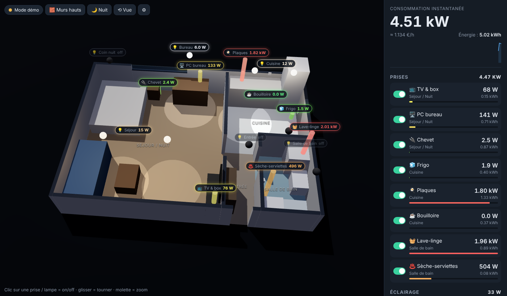

# Studio 3D – plan domotique connecté à Home Assistant

Un mini plan 3D (Three.js) d'un studio où chaque **prise** et chaque **groupe de lampes** affiche sa
consommation en temps réel. Les données viennent de Home Assistant (API WebSocket), ou d'un **mode démo**
qui simule les appareils si aucune connexion n'est configurée.



## Ce que ça fait

- Plan 3D du studio : séjour/coin nuit, cuisine, entrée, salle de bain, meubles, fenêtre.
- **Prises** : une colonne lumineuse sort de chaque prise. Sa hauteur et sa couleur suivent la puissance
  (vert → jaune → rouge, échelle logarithmique ; elle clignote au-dessus de 1 kW).
- **Lampes** : les ampoules s'allument dans la 3D (intensité, couleur RGB si HA la donne), avec un halo au sol.
- **Clic** sur une prise ou une lampe (dans la 3D ou dans la liste) = on/off via Home Assistant.
- Panneau latéral : puissance totale, coût estimé en €/h, courbe des 2 dernières minutes, détail
  par prise et par groupe de lampes (W + kWh).
- Boutons : vue en coupe / murs hauts, jour / nuit, recentrer la vue.

## Lancer en local

Aucun build, c'est du HTML + modules ES (three.js est chargé depuis jsDelivr).

```bash
cd domotique-syst-me-
python3 -m http.server 8000
```

Puis ouvrir http://localhost:8000 → mode démo.

## Brancher sur Home Assistant

### 1. Le matériel (exemples)

| Besoin | Matériel courant | Entités créées dans HA |
|---|---|---|
| Prise avec mesure | Shelly Plug S, Nous A1T (Tasmota), prises Zigbee avec mesure (Aqara, Sonoff S26R2ZB…) | `switch.xxx`, `sensor.xxx_power` (W), `sensor.xxx_energy` (kWh) |
| Circuit de lampes | Shelly 1PM / Plus 1PM derrière l'interrupteur | `light.xxx` ou `switch.xxx` + `sensor.xxx_power` |
| Ampoules connectées | Hue, IKEA, Zigbee… | `light.xxx` (sans mesure, la puissance est **estimée** avec `nominalW`) |

Pour des ampoules sans mesure, l'intégration **PowerCalc** (HACS) crée de vrais capteurs `sensor.xxx_power`.

### 2. Les groupes de lampes

Dans HA : *Paramètres → Appareils et services → Entrées → Créer une entrée → Groupe → Groupe de lumières*,
ex. `light.sejour` avec les 2 spots du séjour. La puissance du groupe peut être la somme de capteurs avec un
groupe de type « Capteur » (méthode *somme*) → `sensor.lumieres_sejour_power`.

### 3. Déclarer tes entités

Tout se passe dans [`src/config.js`](src/config.js) :

```js
{ id: 'prise_tv', type: 'outlet', name: 'TV & box', icon: '📺', room: 'sejour',
  pos: [4.45, 0.3, 4.6], normal: [-1, 0],          // position sur le plan (m) + orientation
  power: 'sensor.prise_tv_power',                    // W
  switch: 'switch.prise_tv',                         // on/off
  energy: 'sensor.prise_tv_energy' },                // kWh (option)

{ id: 'lum_sejour', type: 'light', name: 'Séjour', room: 'sejour',
  points: [[1.4, 3.9], [3.0, 3.9]],                  // emplacement de chaque lampe
  entity: 'light.sejour', power: 'sensor.lumieres_sejour_power', nominalW: 18 },
```

Le plan (pièces, murs, fenêtres, meubles) est dans le même fichier : remplace les coordonnées par celles de ton
logement (en mètres) pour avoir ta propre maison.

### 4. Connexion

1. Dans HA : *Profil → Sécurité → Jetons d'accès longue durée → Créer un jeton*.
2. Dans la page : bouton ⚙ → URL (`http://homeassistant.local:8123`) + jeton → *Se connecter*.
   (Ou renseigne `haUrl` / `token` dans `SETTINGS` de `config.js`.)

### 5. L'afficher dans un tableau de bord HA

Copie le dossier dans `/config/www/studio3d/` de Home Assistant, puis ajoute une carte **Page Web**
(*iframe*) avec l'URL `/local/studio3d/index.html`. Comme la page est alors servie par HA lui-même,
le champ URL peut rester vide (même origine).

> Le jeton est stocké dans le `localStorage` du navigateur. Ne publie pas cette page sur Internet avec un jeton
> codé en dur dans `config.js`.

## Structure

```
domotique-syst-me-/
├── index.html      page + import map three.js
├── style.css       interface
└── src/
    ├── config.js   plan du studio + appareils + entités HA   ← à adapter
    ├── main.js     scène 3D, étiquettes, panneau, interactions
    ├── ha.js       client WebSocket Home Assistant (auth, états, événements, toggle)
    └── demo.js     simulateur (frigo, lave-linge, plaques, bouilloire…)
```

## Pistes pour la suite

- Historique (graphique sur 24 h via l'API `history/history_during_period`).
- Charger un vrai modèle 3D (`.glb` exporté de Sweet Home 3D / Blender) à la place des boîtes.
- Capteurs de température / présence / ouvertures affichés dans les pièces.
- Plusieurs étages.
